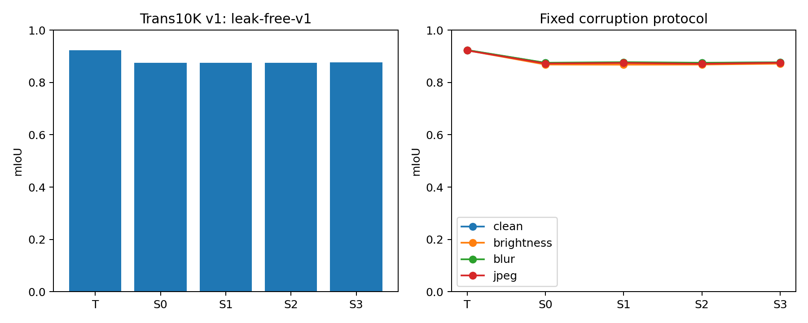
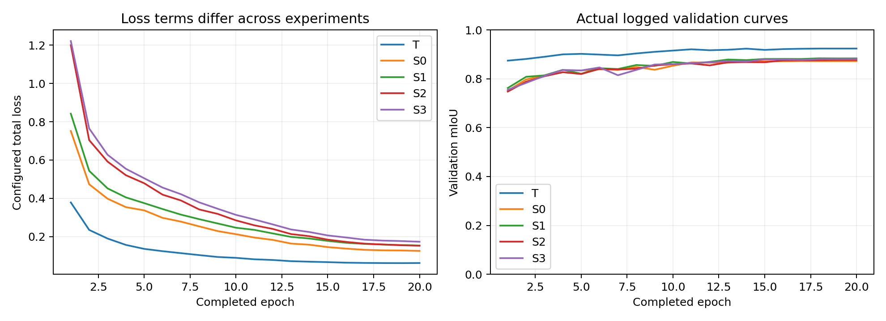

# Transparent Object Segmentation for an Original Jetson Nano

This report draft contains completed host experiments and measured results. The original Nano hardware section remains pending. The system is semantic segmentation, not instance segmentation or object counting.

## Objective and scope

Given one RGB image, predict background, transparent things and transparent stuff at every original-resolution pixel. Transparent surfaces inherit background appearance and can have weak or misleading edges. The project studies edge deployment of a lightweight segmentation model with two established training improvements, rather than claiming an original segmentation architecture.

The teacher is SegFormer-B2, a hierarchical Mix Transformer encoder with an all-MLP fusion decoder. The teacher starts from NVIDIA's ADE20K weights and receives a new three-class classifier, and was fine-tuned for 20 epochs on the audited Trans10K protocol. MobileNetV3-Large supplies the student's approximately 1/4, 1/8, 1/16 and 1/32 features. Learned 1x1 projections map them to 64 channels; bilinear upsampling, summation and depthwise/pointwise convolution fuse the pyramid. A three-channel classifier produces logits. The measured three-class B2 implementation has 27,348,931 parameters; the student inference network has 3,064,819. The auxiliary boundary head adds 18,497 parameters during training and is removed for deployment.

## Data and integrity

The official Trans10K v1 source index contains 5000 training, 1000 validation and 4428 test images. Exact decoded-image audit discovered 11 cross-split duplicate groups. The actual experiment protocol, explicitly named leak-free-v1, uses 4990 training and 999 validation images while preserving the full 4428-image test set. Ten training and one validation entries are excluded only from derived manifests to prevent overlap; original files and source indices remain intact. The foreground labels represent things such as bottles and stuff such as glass walls. The official RGB mask channel means 0/85/255 map to internal classes 0/1/2; internal 255 is reserved for ignore/padding. Unknown encodings fail rather than becoming background. Trans10K v2 reuses images with a finer taxonomy and is not an independent cross-dataset evaluation.

The audit records pairing, resolution, raw colors, class populations, damaged files, official counts and duplicates. Eighteen training masks have visually confirmed 90-degree orientation errors; an explicit SHA-bound recipe corrects them without changing source files, labels or split membership. Sixteen rotate clockwise and two counterclockwise. Validation/test geometry is unchanged. See DATA_AUDIT.md and the diagnostic sheets. Keep the actual audit receipt with the report. Any self-captured material is grouped by object/session before splitting, with adjacent video frames in one group; it is reported separately from the public benchmark.

All inputs use RGB, ImageNet normalization and square letterboxing. Mask interpolation is nearest-neighbor, with ignore padding. A deterministic cache retains resized training images and labels without changing augmentation results. Evaluation upsamples floating logits to the network input grid, removes the exact padding and resizes to the original grid before argmax.

## Losses

Let V denote valid pixels. The segmentation term is cross-entropy averaged over V plus Dice averaged over foreground classes 1 and 2:

`Lseg = CE_valid + mean_c(1 - (2 sum(p_c*y_c) + eps)/(sum(p_c) + sum(y_c) + eps))`.

For an absent foreground class, the corresponding term is its mean predicted foreground probability over valid pixels, explicitly penalizing false positives. An all-ignore batch returns a differentiable zero. FP32 reductions avoid FP16 pixel-sum overflow.

The auxiliary boundary target marks unequal adjacent valid semantic labels, dilates by a fixed radius of one training pixel and excludes invalid neighborhoods. A light decoder feature head predicts the boundary. Positive and negative BCE contributions are balanced when both exist; single-class targets use ordinary BCE. The head is training-only and has no dependency path into main logits.

Output distillation uses frozen eval-mode teacher probabilities on the exact same geometrically transformed images:

`Lkd = T^2 / |V| * sum_{i in V} KL(softmax(z_teacher/T) || softmax(z_student/T))`.

The teacher's output is bilinearly aligned before KL. Different normalization, if configured, is converted on the same image tensor. The total is `Lseg + lambda_b*Lboundary + lambda_kd*Lkd`. S0 disables both, S1 enables boundary only, S2 distillation only, and S3 both. Disabled branches do not instantiate unused teacher dependencies or contribute losses.

## Experimental controls

Use docs/EXPERIMENTS.md and the actual effective config files. Student initialization, input size, decoder width, data, augmentation, optimizer, seed, budget and selection rule are controlled. Small calibration choices use validation only and are recorded independently from the complete final runs. Teacher validation must exceed S0 before formal distillation.

The measured T/S0/S1/S2/S3 metrics and corruption scores are included below and in results/final/results.json. The complete candidate calibration selected boundary weight 0.2, distillation temperature 2 and distillation weight 0.25. Unsuccessful and small-gain ablations are retained.

## Deployment and optimization

Export only the student inference graph with fixed batch=1 and size 256/384/512; the main candidate uses ONNX opset 11. Removing the auxiliary head must preserve logits exactly in eval mode. Host export checks maximum/mean absolute logit differences and argmax agreement using ONNX Runtime; the companion NPZ permits the same check on Nano.

Nano optimization compares TensorRT FP32 versus FP16 and three input resolutions. Engines are generated on the original Nano with its JetPack 4.6.x/TensorRT 8.x installation. Resource and latency measurements require that actual board. Accuracy-speed tradeoffs are reported separately from the two training improvements.

Pure engine execution uses synchronized CUDA events. End-to-end latency includes capture, preprocessing, inference, restoration, overlay and output. A bounded asynchronous queue prioritizes the newest frame and explicitly records discarded frames and frame age. Warmup is excluded; mean, P50, P95, processing FPS, power mode, RAM, GPU utilization and temperatures are retained. Missing telemetry stays unavailable.

## Current engineering evidence

Host regressions cover masks, coordinates, manually computable metrics, degenerate losses, teacher gradients, exact epoch-boundary resume, auxiliary removal, ONNX alignment and image/video/headless operation. A separately installed CPU environment runs the same checks. Synthetic colored-shape overfit results are functional diagnostics only. All host experiment, export, replay and remote artifact checks have now been executed. Nano performance remains unmeasured.

## Limitations

RGB alone cannot fully disambiguate every transparent surface; mirrors, thin edges, clutter and severe reflections can fail. The teacher is heavier than the deployment student. Edge constraints, board thermal state and scene domain shift must be measured. This report must distinguish implemented code, real-data model quality and physical-board validation.

References: [TransLAB/Trans10K](https://xieenze.github.io/projects/TransLAB/TransLAB.html), [Trans2Seg](https://github.com/xieenze/Trans2Seg), [SegFormer](https://github.com/NVlabs/SegFormer), [MobileNetV3 implementation](https://docs.pytorch.org/vision/stable/models/generated/torchvision.models.mobilenet_v3_large.html), [TransCues](https://arxiv.org/abs/2512.07034). Detailed source/version decisions are in docs/SOURCES.md.

<!-- ACTUAL_DELIVERY_BEGIN -->
## Completed host experiments

Protocol: Trans10K v1 leak-free-v1, 4990/999/4428. All models completed 20 epochs. All students used BF16 AMP.
The frozen teacher retains its original FP16 training provenance. Deployment selection used validation only: S1.

T: validation mIoU 0.923996; test mIoU 0.923477; foreground IoU 0.902576; foreground Dice 0.948793; boundary F1 0.189402.
Class IoUs: [0.9612477674578767, 0.9196160455433621, 0.88956717221612]. Brightness/blur/JPEG mIoU: 0.922754/0.923968/0.922368.

S0: validation mIoU 0.872828; test mIoU 0.874782; foreground IoU 0.844392; foreground Dice 0.915632; boundary F1 0.135174.
Class IoUs: [0.9363703056413125, 0.8634865929381734, 0.8244903670018596]. Brightness/blur/JPEG mIoU: 0.868579/0.875359/0.872495.

S1: validation mIoU 0.884096; test mIoU 0.875862; foreground IoU 0.844761; foreground Dice 0.915849; boundary F1 0.137728.
Class IoUs: [0.9372283635746143, 0.8661927710885576, 0.8241640776117325]. Brightness/blur/JPEG mIoU: 0.868105/0.877567/0.874660.

S2: validation mIoU 0.877203; test mIoU 0.874738; foreground IoU 0.845511; foreground Dice 0.916289; boundary F1 0.135518.
Class IoUs: [0.9368994791880686, 0.8614446706174081, 0.825870388307889]. Brightness/blur/JPEG mIoU: 0.868511/0.875351/0.871428.

S3: validation mIoU 0.881062; test mIoU 0.876888; foreground IoU 0.847741; foreground Dice 0.917597; boundary F1 0.137930.
Class IoUs: [0.9378685224207107, 0.8654749815989293, 0.8273197512540852]. Brightness/blur/JPEG mIoU: 0.871893/0.876908/0.875535.

S1 versus S0: clean-test mIoU change +0.1079 percentage points; boundary-F1 change +0.2554 percentage points.
S2 versus S0: clean-test mIoU change -0.0044 percentage points; boundary-F1 change +0.0344 percentage points.
S3 versus S0: clean-test mIoU change +0.2105 percentage points; boundary-F1 change +0.2756 percentage points.

Negative changes are retained. This single-seed comparison does not establish statistical significance.
Figures in results/final are generated from actual logs. The four image columns are original / ground truth / S0 / selected student. Green denotes transparent things, orange denotes transparent stuff, and background is uncolored.
JPEG figure copies are display-sized previews; all metrics use original-resolution labels.
Nano latency, power, temperatures and live camera quality remain pending physical hardware.

<!-- ACTUAL_DELIVERY_END -->

## Interpretation of the measured results

The chosen S1 student reaches 87.5862% clean-test mIoU, compared with 87.4782% for S0: a gain of 0.1079 percentage points. The larger validation gain does not transfer at the same magnitude to the held-out test set. S2 is effectively tied with S0 and is slightly lower in three-class test mIoU. S3 has the highest student clean-test mIoU, 87.6888%, but remains an ablation rather than replacing S1: selecting it after seeing test scores would violate the predefined validation-only selection rule. These small single-seed differences do not support a strong general superiority claim.

The selected student is about 4.76 percentage points below the teacher on clean-test mIoU. Its inference network has 3,064,819 parameters versus 27,348,931 for the teacher; the 384 ONNX file is 12,259,926 bytes. This establishes a size/accuracy tradeoff on the host. It does not establish a Nano speedup before board measurements.

The absolute boundary F1 values are low: 0.1352 for S0 and 0.1377 for S1, using the fixed two-original-pixel tolerance. High region overlap therefore does not imply precise boundaries. The 384 input grid and strict original-grid tolerance are relevant limitations, and visible edge leakage and small holes remain in the decoded replay. Neither metric definitions nor thresholds were changed after seeing test results.

All six fixed examples and all six globally selected worst examples were inspected. Large clear cups and bottles usually retain their main silhouette. The worst cases expose missed broad glass planes, confusion between transparent things and transparent stuff, fragmented masks on display boxes, and false foreground on surrounding furniture. In some examples S1 is worse than S0. The failure figures remain in the report materials rather than being replaced with favorable examples.

Brightness reduction is the most damaging of the three tested appearance changes for the selected student, with mIoU 0.868105 versus 0.875862 clean. The fixed blur score is slightly higher than clean, which is recorded without treating it as proof that blur is beneficial in general. These tests cover fixed synthetic transformations of the same public images, not robustness to new scenes or cameras.

The three replay clips are nine-second sequences made from the same three validation images, with all 90 frames decoded successfully. Their visible timing is host ONNX Runtime timing; it is not Nano latency. Physical Nano testing and real scene recording are the remaining team tasks.
